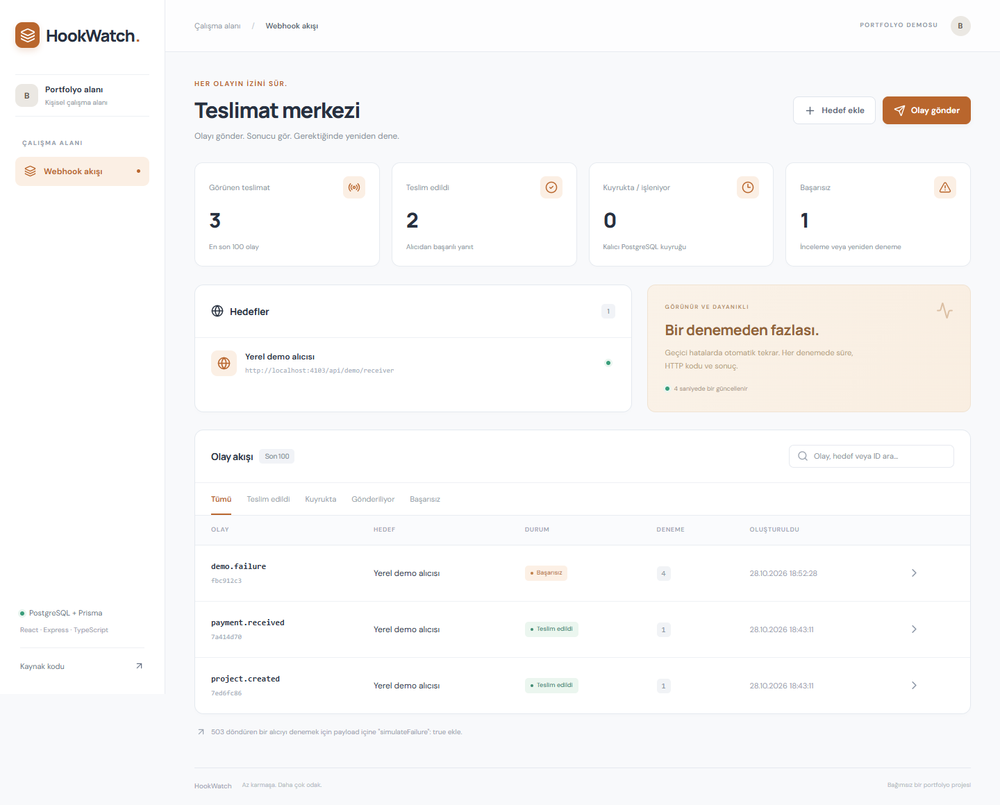

# HookWatch

Her olayın izini sür. Webhook teslimatları için kalıcı kuyruk ve izleme paneli.

React + TypeScript · Express + TypeScript · PostgreSQL + Prisma. Next.js içermez.



[Telefon görünümü](docs/mobile.png)

## Özellikler

- İzin verilen origin listesiyle webhook hedefleri
- JSON olay oluşturma ve son 100 teslimatın takibi
- Gerçek HTTP gönderimi ve HMAC-SHA256 imzası
- PostgreSQL kuyruğu, SKIP LOCKED ile tekil iş sahiplenme
- Süreç çökmesinde 30 saniyelik lease sonunda kurtarma
- Ağ hatası, 408, 429 ve 5xx için 2/4/8 saniye arayla tekrar (toplam 4 deneme)
- Kalıcı hata veya deneme limiti sonrası manuel yeniden deneme
- HTTP kodu, süre ve hata içeren kalıcı deneme geçmişi

## Yerel kurulum

Gereksinimler: Node.js 22.12+, npm ve Docker Compose. PostgreSQL için Docker yerine kendi sunucunu kullanacaksan backend/.env içindeki DATABASE_URL değerini değiştir.

```sh
git clone https://github.com/hassanbera/hookwatch.git
cd hookwatch
npm ci
npm run db:up
npm run setup
npm run dev
```

- Arayüz: http://localhost:5175
- API: http://localhost:4103/api
- Sağlık: http://localhost:4103/api/health
- Yerel PostgreSQL: localhost:55443

`npm run setup`, yoksa backend/.env dosyasını örnekten oluşturur; Prisma Client üretir, sürümlenmiş migration'ları uygular ve örnek verileri ekler. Seed yalnızca boş uygulamaya demo kayıtları ekler, mevcut kayıtları silmez. Compose sadece PostgreSQL'i başlatır; API ve arayüz host üzerinde çalışır. `npm run db:down` veritabanını durdurur; volume içindeki veriler korunur.

## Mimari

```text
frontend/src/
  App.tsx                  # Kullanıcı akışları ve ekran
  components/ui.tsx        # Ortak arayüz bileşenleri
  lib/api.ts               # HTTP istemcisi
  types.ts                 # İstemci veri tipleri
backend/
  prisma/schema.prisma     # Kalıcı veri modeli
  prisma/migrations/       # Sürümlenmiş PostgreSQL migration'ları
  prisma.config.ts         # Prisma CLI bağlantı yapılandırması
  prisma/seed.ts            # Tekrarlanabilir demo kurulumu
  src/modules/hookwatch/
    hookwatch.model.ts       # Girdi şemaları, tipler ve model kuralları
    hookwatch.repository.ts  # Prisma ve veritabanı işlemleri
    hookwatch.service.ts     # İş akışları ve iş kuralları
    hookwatch.controller.ts  # HTTP giriş / çıkış
    hookwatch.routes.ts      # Endpoint eşlemeleri
  src/config/              # Ortam ve Prisma bağlantısı
  src/common/              # Merkezi hata yönetimi
```

İstek akışı: Route → Controller → Service → Repository → Prisma → PostgreSQL. Controller veritabanına erişmez. İlişkiler, indeksler ve silme davranışları Prisma şemasında tanımlıdır. Repository, iş akışının ihtiyaç duyduğu atomik transaction'ları sağlar.

## API

Başarılı yanıtlar `{ "data": ... }`, hatalar `{ "error": "..." }` biçimindedir. Geçersiz girdi 400, eksik kayıt 404, çakışma 409 döndürür.

| Yöntem     | Yol                       | İşlem                                  |
| ---------- | ------------------------- | -------------------------------------- |
| GET        | /api/health               | Veritabanı bağlantısı dahil sağlık     |
| GET / POST | /api/endpoints            | Hedefler / hedef ekle                  |
| GET / POST | /api/deliveries           | Son 100 teslimat / yeni olay           |
| GET        | /api/deliveries/:id       | Teslimat ayrıntıları                   |
| POST       | /api/deliveries/:id/retry | Başarısız teslimatı yeniden kuyruğa al |
| POST       | /api/demo/receiver        | Yerel demo alıcısı                     |

## Doğrulama

```sh
npm run typecheck
npm test
npm run build
```

Testler gerçek PostgreSQL üzerinde HTTP API ve kritik iş kurallarını doğrular. Test komutu kendine ait rastgele isimli bir veritabanı oluşturur, migration uygular ve test sonunda yalnızca bu veritabanını siler. Geliştirme worker’ı ve demo verileri testlere karışmaz. Yerel veritabanı kullanıcısında CREATEDB yetkisi gerekir; Compose ve CI kullanıcısında bu yetki vardır. CI migration, tip kontrolü, test ve build adımlarını çalıştırır. Yerelde test öncesi `npm run setup` çalışmış olmalıdır.

## Yapılandırma ve sınırlar

- Bu sürüm tek çalışma alanlı bir portfolyo demosudur. Giriş ve kullanıcı bazında veri izolasyonu içermez; tüm ziyaretçiler aynı demo kayıtlarını görür ve değiştirir. Özel müşteri verisiyle veya erişimi kısıtlanmamış üretim API'si olarak kullanmadan önce kimlik doğrulama ve yetkilendirme eklenmelidir.
- Sunucu ve Vite geliştirme arayüzü varsayılan olarak yalnızca yerel makineyi dinler. Her proje kendi PostgreSQL volume ve portlarını kullanır.
- Parola ve bağlantı bilgileri yalnızca yerel demo içindir; gerçek dağıtımda environment secret kullan. .env dosyaları Git'e eklenmez.
- Üretim arayüzü için `frontend/dist` statik olarak sunulabilir. Aynı origin altında `/api` isteklerini Express sunucusuna yönlendir. Express'i `npm start -w backend` ile başlat; ters proxy/container kullanırken `HOST=0.0.0.0` değerini dağıtım ortamında tanımla.
- Backend derlemesi ve Prisma migration işlemleri dağıtımda ayrı adımlardır. Sürümler package-lock.json ile sabitlenir; bu başlangıç Prisma 7.10.1 kullanır.
- Arayüz en son 100 teslimatı gösterir; özetler de bu kayıtlar üzerinden hesaplanır.
- WEBHOOK_ALLOWED_ORIGINS virgülle ayrılmış, güvenilen origin listesidir. Yerel demo origin dışında dışarıya gönderim için sunucu yapılandırması gerekir. Redirect takip edilmez; istek zaman aşımı 5 saniyedir. Yalnızca kontrol ettiğin originleri ekle; allowlist tek başına DNS rebinding engeli değildir.
- Teslimat en az bir kez semantiğindedir: alıcı yanıtladıktan sonra worker çökerse olay yeniden gelebilir. Alıcı X-HookWatch-Id ile tekrarları ayıklamalıdır. Lease 30 saniye sonra kurtarılır; deneme sayısında çökme kaynaklı boşluk olabilir.
- WEBHOOK_SIGNING_SECRET tek sunucu anahtarıdır, API üzerinden açığa çıkarılmaz. Alıcı X-HookWatch-Signature içindeki sha256=<hex> değerini HMAC-SHA256(secret, timestamp + "." + hamJSONGövdesi) ile sabit zamanlı karşılaştırmalıdır. X-HookWatch-Timestamp için de kabul edilebilir süre penceresi kontrol edilmelidir.
- WORKER_ENABLED=false, otomatik işleyiciyi kapatır. Normal çalışmada worker API süreciyle başlar ve kapanışta devam eden işi bekler.
- Demo alıcı data.simulateFailure=true için 503, diğer olaylar için 200 döndürür. Yeni olayda payload içine simulateFailure ekle; elle yeniden deneme olay verisini değiştirmez.
